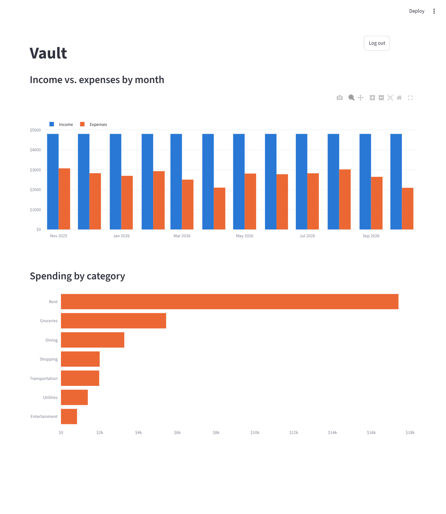
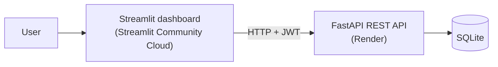

# Vault
A full-stack Python application featuring a REST API built with FastAPI and an interactive dashboard for data visualization. Built as a personal development project to demonstrate end-to-end application development.

All data is randomly generated sample data.



## Live demo
- **Dashboard:** _link coming soon_
- **API docs (Swagger):** _link coming soon_
- **Demo login:** `demo` / `demo123`

The API runs on a free tier and sleeps when idle, so the first request can take up to a minute.

## Architecture


- **Database:** two tables, `user` and `transaction` (`transaction.user_id` → `user.id`), defined with SQLModel.
- **API:** FastAPI. Login returns a JWT; every data endpoint requires it and only returns the logged-in user's records.
- **Dashboard:** Streamlit and Plotly. It never touches the database; all data comes through the API.
- **Sample data:** `scripts/seed.py` creates the demo user and ~12 months of transactions with Faker. The API runs it on startup if the demo user is missing.

| Path | Purpose |
|---|---|
| `api/main.py` | App setup and startup |
| `api/database.py` | Database connection |
| `api/models.py` | Tables and request/response schemas |
| `api/auth.py` | Password hashing, JWT, `/login` |
| `api/routers/transactions.py` | Transactions CRUD |
| `api/routers/summary.py` | Summary endpoints |
| `dashboard/app.py` | Streamlit dashboard |
| `scripts/seed.py` | Sample data generator |

## API endpoints
All endpoints except `/health` and `/login` require an `Authorization: Bearer <token>` header.

| Method | Path | Description |
|---|---|---|
| POST | `/login` | Get a JWT (form fields `username`, `password`) |
| POST | `/transactions` | Create a transaction |
| GET | `/transactions` | List transactions, newest first |
| GET | `/transactions/{id}` | Get one transaction |
| PATCH | `/transactions/{id}` | Update a transaction |
| DELETE | `/transactions/{id}` | Delete a transaction |
| GET | `/summary/by-category` | Spending totals per category |
| GET | `/summary/by-month` | Income and expense totals per month |
| GET | `/health` | Health check |

Amounts are positive for income and negative for expenses.

## Local setup
Requires Python 3.11+.

```bash
git clone https://github.com/jmspringr/vault.git
cd vault
python3 -m venv .venv
source .venv/bin/activate
pip install -r requirements.txt
cp .env.example .env
```

Start the API (creates and seeds `vault.db` on first run):
```bash
uvicorn api.main:app --reload
```

In a second terminal, start the dashboard:
```bash
streamlit run dashboard/app.py
```

- Dashboard: http://localhost:8501
- API docs: http://localhost:8000/docs

## Usage
**Dashboard:** log in with `demo` / `demo123` to see income vs. expenses by month and spending by category.

**API:** open `/docs`, click **Authorize**, log in with the demo account, then try any endpoint. Or with curl:
```bash
TOKEN=$(curl -s -X POST http://localhost:8000/login \
  -d "username=demo&password=demo123" | python3 -c "import sys,json; print(json.load(sys.stdin)['access_token'])")

curl http://localhost:8000/summary/by-category -H "Authorization: Bearer $TOKEN"

curl -X POST http://localhost:8000/transactions \
  -H "Authorization: Bearer $TOKEN" -H "Content-Type: application/json" \
  -d '{"date": "2026-10-01", "amount": -24.99, "category": "Dining", "description": "Lunch"}'
```

## Environment variables
| Variable | Used by | Default |
|---|---|---|
| `DATABASE_URL` | API | `sqlite:///./vault.db` |
| `JWT_SECRET` | API | Local-only fallback; set a real value when deployed |
| `API_URL` | Dashboard | `http://localhost:8000` |

## Deployment
- **API:** Render free web service, configured by `render.yaml` (generates `JWT_SECRET` automatically). The SQLite file resets on each deploy and is re-seeded on startup.
- **Dashboard:** Streamlit Community Cloud, main file `dashboard/app.py`, with `API_URL` set in the app's secrets.
